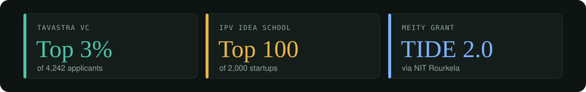

  
  
  

 

### Hi, I'm Manas 👋

I'm building **[Ateegnas](https://ateegnas.com)**. We help AI companies get clean, reliable data, because good AI starts with good data.

 

 

### Things I've built

- 🧠 **[Kazbrekker](https://huggingface.co/roy2231/Kazbrekker)**: reads a piece of text and tells you if it's positive, negative or neutral
- 🧩 **[Remember](https://github.com/Roy2231/Remember)**: gives AI assistants a memory, so they don't forget past conversations
- 🏷️ **[JustBid](https://github.com/Roy2231/Justbid)**: helps founders find the best startup deals in one place

 

  <b>Let's talk</b>  
  

